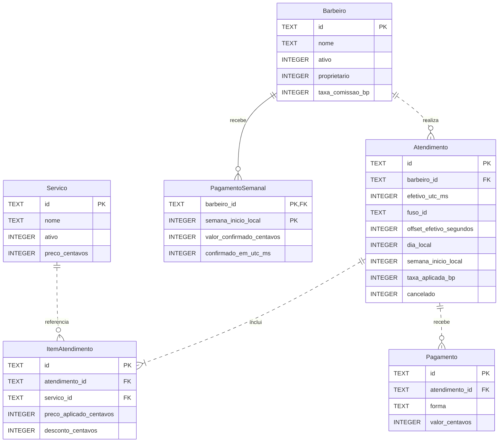

# Modelo de dados do SX Gestão

Modelo para Room/SQLite no MVP offline. O modelo segue o [SRS](srs.md), as [regras de negócio](business-rules.md), a [arquitetura](architecture.md) e as [instruções do projeto](../AGENTS.md).

## Decisões implementadas

Room v1 mantém o DER abaixo, sem alteração de esquema durante a integração.
`java.time` usa desugaring 2.1.5. Horas inexistentes são rejeitadas; horas ambíguas
exigem offset explícito. Edição temporal inalterada preserva os campos históricos.
Leituras de filhos têm ordenação canônica por UUID no repositório.

Backup JSON v1 e validação/substituição transacional: `backup-format.md`.
Não há cópia ou troca de arquivos SQLite/WAL abertos nem fallback destrutivo.
As perguntas do modelo inicial ao fim foram resolvidas nesses contratos;
evidências em `implementation-checklist.md`.

## DER

Cada atendimento tem exatamente um barbeiro. Cada item pertence a um atendimento e referencia um serviço. Um atendimento gravado tem ao menos um item. A quantidade de partes do pagamento é zero se o líquido for zero e uma ou mais se for positivo. Cada confirmação pertence a um barbeiro, com no máximo uma por semana. Os atendimentos são associados à apuração pelo par barbeiro e segunda-feira local. A confirmação é opcional e sua existência é independente das FKs dos atendimentos.

## Dicionário de dados

Todos os campos são obrigatórios. A aplicação gera UUIDs antes da inserção de Barbeiro, Servico, Atendimento, ItemAtendimento e Pagamento. Persista os UUIDs e suas FKs como `TEXT` em formato canônico minúsculo com hífens. Preserve as chaves dos registros mantidos em edições e na restauração. Valores monetários são `INTEGER` / `Long` em centavos de real. Taxas são inteiros em pontos-base. Por exemplo, 33,33% é 3333 e 100% é 10000. Indicadores booleanos são inteiros 0 ou 1.

| Entidade | Campos | Significado |
| --- | --- | --- |
| Barbeiro | `id`, `nome`, `ativo` | PK, nome do cadastro e disponibilidade para novas associações. |
| Barbeiro | `proprietario`, `taxa_comissao_bp` | Indicador de proprietário e taxa vigente. Proprietário sempre em 0, demais iniciam em 5000. |
| Servico | `id`, `nome`, `ativo`, `preco_centavos` | PK, nome, disponibilidade e preço vigente não negativo. |
| Atendimento | `id`, `barbeiro_id`, `cancelado` | PK, FK para Barbeiro e indicador de cancelamento lógico. |
| Atendimento | `efetivo_utc_ms`, `fuso_id`, `offset_efetivo_segundos` | Instante efetivo em milissegundos desde a época Unix, identificador do fuso capturado no lançamento e deslocamento UTC aplicado à hora efetiva. |
| Atendimento | `dia_local`, `semana_inicio_local` | Dias inteiros desde 1970-01-01 no calendário civil ISO. Representam a data efetiva local e a segunda-feira da respectiva semana. São derivados na gravação e usados nas consultas históricas. |
| Atendimento | `taxa_aplicada_bp` | Snapshot da taxa aplicada ao barbeiro do atendimento. |
| ItemAtendimento | `id`, `atendimento_id`, `servico_id` | PK própria e FKs para Atendimento e Servico. Cada ocorrência tem seu próprio ID, inclusive quando o serviço se repete. |
| ItemAtendimento | `preco_aplicado_centavos`, `desconto_centavos` | Snapshot do preço unitário aplicado e desconto fixo registrado, entre zero e esse preço. |
| Pagamento | `id`, `atendimento_id`, `forma`, `valor_centavos` | PK, FK para Atendimento, código estável (`PIX`, `DINHEIRO`, `DEBITO`, `CREDITO`) e valor positivo da parte do pagamento recebido no registro. |
| PagamentoSemanal | `barbeiro_id`, `semana_inicio_local`, `valor_confirmado_centavos` | PK composta pelas duas primeiras colunas, com FK para Barbeiro e segunda-feira na mesma unidade de Atendimento. A linha registra a confirmação integral e o valor apurado naquele momento, inclusive zero. Ausência de linha representa pendência. |
| PagamentoSemanal | `confirmado_em_utc_ms` | Instante da confirmação em `INTEGER` / `Long`, em milissegundos desde a época Unix em UTC. |

A chave composta de PagamentoSemanal usa o UUID do barbeiro e a segunda-feira local, o mesmo par usado nas consultas e no bloqueio. A PK identifica a confirmação e garante unicidade com um único índice.

Na inclusão, capture o fuso do aparelho e resolva nele a data e hora efetivas. Ao editar a data ou hora, mantenha o identificador do fuso original e recalcule instante, deslocamento e chaves civis em conjunto. Nas demais edições preserve os campos temporais. Consulte a data e a semana gravadas, inclusive após mudanças de fuso do aparelho ou das regras do fuso. Use intervalos civis com início inclusivo e fim exclusivo. A semana corresponde a `[segunda, segunda + 7 dias civis)`, sem assumir 168 horas UTC. A chave semanal é a data da segunda-feira, compartilhada pelos lançamentos classificados nessa semana mesmo quando seus fusos de lançamento diferem.

## Restrições no SQLite

- Declare PKs e FKs do DER, com `NOT NULL` explícito nas colunas obrigatórias, inclusive na PK composta. Habilite e verifique a integridade referencial. Use `RESTRICT` para exclusões e mudanças de chave referenciada. O repositório inativa cadastros e cancela atendimentos com atualização de estado. Filhos substituídos durante edição podem ser removidos na transação do atendimento.
- A PK de PagamentoSemanal garante unicidade mesmo sob concorrência. O atendimento admite repetição de serviço e as partes de pagamento usam sua própria PK, sem unicidade por forma.
- Declare PKs, FKs, nulabilidade e índices nas entidades Room. O SQLite garante essas restrições. Use os tipos Kotlin do mapeamento Room e valide no repositório o formato canônico dos UUIDs, os booleanos, taxas de 0 a 10000 pontos-base, taxa zero para o proprietário, preços e valor semanal não negativos, descontos de zero até o preço aplicado, partes positivas e formas admitidas. As validações de domínio e de agregado ocorrem na transação de gravação, sem `CHECK` manual.

### Índices iniciais

| Tabela | Colunas na ordem do índice | Finalidade |
| --- | --- | --- |
| Atendimento | `(barbeiro_id, semana_inicio_local, cancelado)` | Consulta dos atendimentos válidos na apuração semanal por barbeiro. Cobre a FK. |
| Atendimento | `(dia_local)` | Histórico e consultas diárias ou intervalos de dias, inclusive faturamento semanal. |
| ItemAtendimento | `(atendimento_id)`, `(servico_id)` em índices separados | Carregar itens e localizar referências de cada FK. |
| Pagamento | `(atendimento_id)` | Carregar partes e apurar por forma dentro dos atendimentos do período. Cobre a FK. |
| PagamentoSemanal | PK `(barbeiro_id, semana_inicio_local)` | Unicidade, consulta por par e cobertura da FK. |

Ajuste os índices conforme o plano das consultas reais. A consulta da confirmação e a verificação do bloqueio por par reutilizam a PK.

## Validações e transações da aplicação

### Conclusão, edição e cancelamento

O repositório lê o estado atual, valida o estado proposto, verifica as confirmações semanais e grava as alterações em uma única transação Room. A mesma fronteira abrange o cabeçalho, os itens e as partes. A validação de tela orienta o usuário e a validação transacional usa os dados vigentes no banco.

- Conclusão exige barbeiro e serviços ativos, pelo menos um item e descontos válidos. Valide a entrada da taxa com até duas casas decimais antes de convertê-la em inteiro. Aplique a taxa e os preços vigentes como snapshots.
- Edite somente atendimento válido. Preserve o preço de cada item mantido, inclusive ao alterar seu desconto, e a taxa se o barbeiro for mantido. Inclusões e substituições usam serviços ativos e preço vigente. A troca exige barbeiro ativo e usa a taxa vigente. Vínculos inativos já existentes podem ser mantidos. As FKs preservam a identificação histórica dos cadastros.
- Calcule o líquido somando `preco_aplicado_centavos - desconto_centavos` de cada item. Se positivo, exija uma ou mais partes positivas com soma exatamente igual. Se zero, exija zero partes. Revalide o agregado após qualquer edição. A quantidade mínima de itens, a quitação, a atividade dos cadastros e a coerência dos campos temporais dependem da aplicação.
- Cancelar exige confirmação explícita e altera apenas o indicador. Preserve itens, snapshots e partes. Exclua cancelados de todas as apurações. Uma falha ou recusa deixa o estado anterior íntegro.

### Apuração e fechamento semanal

Derive líquido e comissão dos dados aplicados. Some o líquido uma vez por atendimento válido no período. Some as partes de atendimentos válidos separadamente por forma, evitando multiplicar valores ao cruzar itens e partes. Use aritmética inteira com somas verificadas para detectar estouro de `Long`.

A comissão por atendimento é `HALF_UP(liquido_centavos × taxa_aplicada_bp / 10000)`. Em Kotlin puro, para valores não negativos, decomponha o líquido em quociente e resto por 10000. Calcule `quociente × taxa + (resto × taxa + 5000) / 10000` com divisão inteira para evitar estouro do produto integral. Some as comissões já arredondadas por barbeiro e semana. Por exemplo, a 50%, dois itens de 1 centavo no mesmo atendimento rendem 1 centavo de comissão. Dois atendimentos separados de 1 centavo rendem 2 centavos ao todo.

Na conclusão, verifique o par `(barbeiro_id, semana_inicio_local)` proposto, inclusive em lançamento retroativo. Na edição, verifique o par persistido na origem e o par proposto no destino. No cancelamento, verifique o par persistido. A existência de PagamentoSemanal em qualquer par verificado bloqueia a operação inteira até o desfazimento explícito das confirmações que a impedem. Isso inclui correções apenas da forma de pagamento e operações com comissão zero ou valor arredondado inalterado.

Confirme lendo e somando os atendimentos válidos e inserindo o total integral e `confirmado_em_utc_ms` na mesma transação de escrita. Se a confirmação já existir, retorne seu valor e instante originais. Use a PK para garantir a unicidade e, em conflito, releia a linha vencedora sem substituí-la. Para desfazer, após confirmação explícita, remova somente a linha semanal. A apuração volta ao estado pendente. A reconfirmação grava o total vigente e o instante da nova confirmação. Confirmação, desfazimento e gravações de atendimentos usam transações de escrita serializadas com as leituras de decisão dentro delas. Se a alteração gravar primeiro, a confirmação usa o estado atualizado. Se a confirmação gravar primeiro, a alteração fica bloqueada.

## Backup integral

Exporte por SAF um retrato consistente das seis tabelas e dos metadados necessários à compatibilidade, incluindo IDs, cadastros inativos, cancelamentos, filhos, snapshots, dados temporais e confirmações com `confirmado_em_utc_ms`. A restauração valida uma cópia candidata isolada antes de pedir confirmação explícita. Verifique completude, versão compatível, integridade estrutural, tipos efetivos, UUIDs canônicos, chaves e regras do agregado, inclusive as somas das partes e a igualdade entre cada confirmação e sua apuração. Valide a coerência temporal pelos dados históricos gravados, sem reinterpretá-los pelo fuso atual. Valide snapshots pelos seus domínios e vínculos históricos, sem compará-los ao preço ou taxa vigente.

Restaure a mesma cópia validada e confirmada. Substitua todo o conjunto como uma operação atômica, coordenada com o acesso do repositório. Garanta que falha ou interrupção preserve a base anterior e que a aplicação exponha apenas um estado integral. Se o formato for SQLite, considere a consistência do WAL na captura e na troca. Use apenas o acesso concedido aos arquivos selecionados pelo SAF.

## Conferência com o SRS

Os casos complementam os [critérios de aceite](srs.md#requisitos-funcionais-e-critérios-de-aceite) e as [regras de comissão](business-rules.md#comissões-e-pagamento-semanal). Verifique em Room a rejeição de PK duplicada, FK órfã e campos obrigatórios nulos. Verifique a preservação dos UUIDs dos registros mantidos em uma edição.

| Requisitos | Casos a verificar na implementação |
| --- | --- |
| RF-01 a RF-05, RNF-03 | Proprietário em 0%, 33,33% aceito e 33,333% rejeitado. Serviço repetido e desconto integral. R$ 25,00 quitados com R$ 10,00 + R$ 15,00. Total zero sem partes. Cadastro alterado ou inativado preserva snapshots e vínculos. Edição inválida preserva o agregado. Cancelamento preserva histórico e exclui valores. |
| RF-06 e RF-07 | Domingo retroativo e segunda à meia-noite em semanas distintas. Troca de fuso preserva a classificação. Arredondamento por atendimento conforme os exemplos. |
| RF-08, RNF-04 | Bloquear retroativo, edição só da forma de pagamento e cancelamento em semana confirmada, inclusive com comissão zero ou arredondada igual. Mover entre barbeiros e entre semanas com apenas origem, apenas destino e ambos confirmados. Conferir preservação integral após o bloqueio. Confirmar em paralelo e conferir um único registro com valor e instante originais. Concorrer confirmação e edição sem impacto na comissão e testar as duas ordens de gravação. Desfazer, corrigir e reconfirmar com o total vigente e novo instante. |
| RF-09, RNF-01 e RNF-06 | Backup offline com restauração dos UUIDs, vínculos e instante de confirmação, rejeição de arquivo incompleto, inválido ou incompatível, recusa da confirmação e falha durante a troca com preservação após reabrir. Testar também recusa de cancelamento e desfazimento. |
| RNF-02 e RNF-05 | Confirmar compatibilidade com API 24 na implementação. As telas devem apresentar erros acionáveis de validação e atender aos critérios de acessibilidade do SRS. |

## Decisões técnicas em aberto

- Validar a representação temporal e os índices propostos com as consultas reais. Definir como tratar hora local ambígua ou inexistente em transições de fuso e qual API de calendário usar em Android 24, inclusive eventual desugaring.
- Escolher versões de Room e KSP compatíveis com o projeto e o Android 24. Exportar o esquema e verificar criação e migrações versionadas quando houver base anterior.
- Definir formato, versão, matriz de compatibilidade, mecanismos de validação e estratégia de substituição recuperável do backup. Revisar a configuração de backup automático do template conforme a arquitetura.
